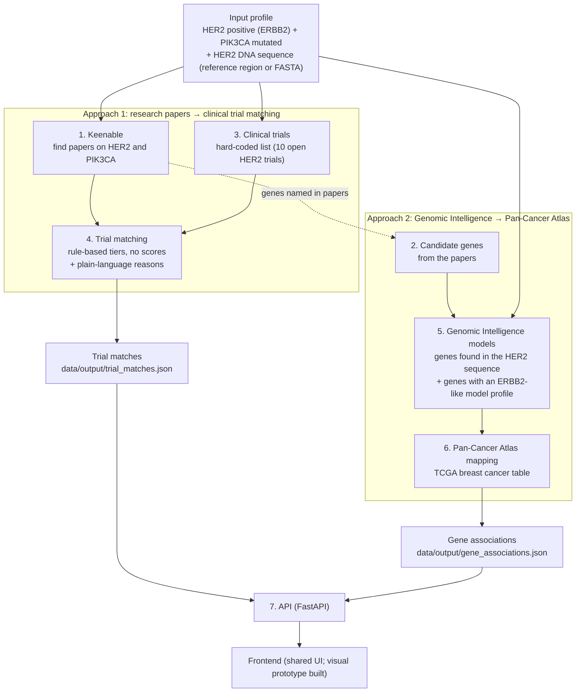

# AGENTS.md

Ground truth for every coding agent working in this repo. Read this file fully before writing code. If something here conflicts with a teammate's chat message, this file wins until it is edited. `CLAUDE.md` imports this file, so there is no separate `claude.agent.md`. `README.md` is the overview for people and `HUMAN.md` is the live progress tracker.

> **Architecture v2 (2026-11-14): personalized medicine research platform.** The project no longer ranks trials with scores. It takes a biomarker profile (HER2 + PIK3CA) and runs two parallel approaches: papers → clinical trial matching (**built**), and DNA model → Pan-Cancer Atlas gene mapping (Task 3). **The old scoring system is removed** (section 5). Build status per task is in `HUMAN.md`; rows marked *planned* below are not built yet.

## Active frontend override: Plan B (2026-11-14)

Contactashmeetsingh explicitly changed the frontend task to a self-contained saved-data demo. This section takes precedence over the platform architecture below for `frontend/` only. Preserve backend work.

- Use the saved files from `main`, pinned to a commit in `frontend/data/plan-b.json`; no backend, live sponsor calls, Python virtualenv, or run-time research pipeline is required.
- Stage 1: HER2 positive → potentially matching trials from `clinical_trials/trial_ops.csv`.
- Stage 2: HER2 positive + PIK3CA mutation → the Keenable interaction evidence, saved Genomic Intelligence readouts, and a narrower trial shortlist from that same CSV.
- A smooth interactive presentation is authorized. Keep a discreet saved-data/source label; do not imply live searches or model execution.
- The main GI table explicitly omits expression predictions: show promoter/chromatin readouts and “overexpression not established,” never relabel them as expression predictions.
- HER2-negative/low studies are not HER2-positive matches. Marker tags alone do not confirm eligibility. Keep ambiguous and mixed-cohort candidates separate from titles explicitly naming both profile statuses.
- Preserve evidence labels and the research disclaimer. No treatment recommendations or invented results.
- PSMD3 follow-up: show saved regulatory readouts and literature, with immediately visible bortezomib and carfilzomib cards. The user-requested five-minute timer unlocks extended literature only. The curated `frontend/data/psmd3-followup.json` adds primary literature and official labels. Keep this provenance distinct from saved model outputs. These drugs inhibit the wider proteasome, not established direct PSMD3 targeting; breast-cancer evidence shown is preclinical. Jigyasa's user-supplied expression estimates are explicitly team-reported, pending source verification, not model outputs or verified atlas statistics. No simulated live analysis or ChatGPT integration.

## 1. Mission

Build a working proof of concept of a personalized medicine **research** platform. Given a biomarker profile, it:

1. finds supporting research papers and potentially relevant clinical trials, and explains why each trial may be relevant (Approach 1);
2. runs the HER2 DNA sequence through the Genomic Intelligence models and maps the predicted genes onto Pan-Cancer Atlas data (Approach 2).

It must run end to end for one profile. Breadth and scale are out of scope. A frontend visual prototype was explicitly authorized by Contactashmeetsingh on 2026-11-14. Following up on the genes it reports is the researcher's job, not ours.

This is a research demo. It is not medical advice, it makes no treatment recommendation, and every output must say so.

## 2. The input (fixed for the PoC)

**The profile**, stored at `data/input/profile.json`:

| Biomarker | Gene | Alteration | Status | Aliases (to spot it in trial and paper text) |
|---|---|---|---|---|
| HER2 | ERBB2 | overexpression / amplification | positive | HER2, ERBB2, HER-2, HER2/neu, ErbB-2, ErbB2, and the spelled-out "human epidermal growth factor receptor 2" forms |
| PIK3CA | PIK3CA | mutation | mutated (yes/no; `variant` stays null for the PoC) | PIK3CA, PI3KCA, p110alpha, p110α |

Plus `tissue` (Breast) and `sequence_gene` (ERBB2): the gene whose DNA sequence feeds Approach 2.

**The DNA sequence** for Approach 2 is either the ERBB2 reference region (default, fetched server-side by Genomic Intelligence) or a FASTA file the user supplies. *(FASTA input: planned, Task 3.)*

**Model conditioning** for the sequence gene stays in `data/input/biomarker.json` (`model_context`: expression target "HER2-positive breast cancer cell line", reference "liver tissue", chromatin cell types HMEC, MCF-7, T-47D; plus `sanity_genes`, logged only).

Never bury a biomarker name in pipeline code. Read it from the profile so more rows can be added later.

## 3. System overview

Two approaches that run in parallel from the same profile and are shown separately.



**Approach 1: research papers → clinical trial matching**

1. **Literature.** Use Keenable to find papers about each profile biomarker. Output: papers with the genes they mention.
3. **Trials.** A hard-coded list of clinical trials (the 10 open HER2 trials in `clinical_trials/her2_candidate_marker_open_trials.xlsx`, sheet "Open HER2 trials"). No live search.
4. **Trial matching.** For each trial, check which profile biomarkers its criteria require or mention, which drugs it uses and what they target, and which papers support those genes. Group trials into tiers and write a plain-language reason. **No numeric score.**

**Approach 2: Genomic Intelligence → Pan-Cancer Atlas**

2. **Candidate genes.** The genes the papers link to HER2 (30 today). This is the set the DNA models are run on.
5. **Genomic Intelligence.** Run the models on the HER2 sequence and on each candidate gene. Two kinds of "related gene" prediction:
   - **Locus genes:** genes the gene finder places inside the supplied HER2 sequence, named by Ensembl coordinates.
   - **Similar-profile genes:** candidate genes whose seven-task model profile is most like ERBB2's.
   Genomic Intelligence has **no sequence-similarity search**; these two methods are how we produce "similar / related genes". Say so wherever results are shown.
6. **Atlas mapping.** Look up every predicted gene, plus ERBB2 and PIK3CA, in the Pan-Cancer Atlas table and attach what it says (co-amplification with ERBB2, expression change, mutation rate, protein difference).

**Output**

7. **API.** Serves the profile, both result files and the supporting caches. The shared frontend in `frontend/` renders these results. Contactashmeetsingh explicitly authorized its visual prototype on 2026-11-14; coordinate future frontend changes with Sumaya.

## 4. Stage contracts

Every stage reads JSON, writes JSON, and can be run alone. Stages talk only through these files. If you change a schema, update this section in the same commit.

| # | Stage | Approach | Module | Reads | Writes | Built? |
|---|---|---|---|---|---|---|
| 0 | Input | both | `backend/pipeline/profile.py`, `biomarker.py` | `data/input/profile.json`, `biomarker.json` | (in memory) | yes |
| 1 | Literature | 1 | `backend/pipeline/literature.py` | profile, drug_targets, gene_candidates (vocabulary only); Keenable + PubMed on `--refresh` | `data/cache/papers.json` (+ `keenable_queries.json`) | yes: 29 curated + 33 merged Keenable hits |
| 2 | Gene candidates | 2 | `backend/pipeline/targets.py` | biomarker, papers, drug_targets, Ensembl cache | `data/cache/gene_candidates.json` | yes |
| 3 | Trials | 1 | `backend/pipeline/trials.py` | `clinical_trials/her2_candidate_marker_open_trials.xlsx` (both sheets); biomarker for `--ctgov` / mock | `data/cache/trials.json` | yes: 10 real trials |
| 4 | Trial matching | 1 | `backend/pipeline/matching.py` | profile, papers, gene_candidates, trials, drug_targets, gene_terms | `data/output/trial_matches.json` | yes |
| 5 | Genomic Intelligence | 2 | `backend/pipeline/genomic.py` | gene_candidates, biomarker | `data/cache/genomic_context.json` (+ side caches) | per-gene profiles yes; sequence/FASTA input *planned (Task 3)* |
| 6 | Atlas mapping | 2 | `backend/pipeline/atlas.py` | genomic_context, sequence scan, atlas CSV, profile | `data/output/gene_associations.json` | *planned (Task 3)* |
| 7 | API | both | `backend/app/main.py` | everything above | HTTP | yes for built stages |

### Schemas

```jsonc
// data/input/profile.json
{ "tissue": "Breast",
  "biomarkers": [{ "biomarker": "HER2", "gene": "ERBB2", "alteration": "overexpression / amplification",
                   "status": "positive", "variant": null, "aliases": ["HER2", "ERBB2"] }],
  "sequence_gene": "ERBB2" }

// papers.json
[{ "paper_id": "PMID or DOI", "title": "", "year": 2024, "url": "",
   "genes_mentioned": ["ERBB2", "PIK3CA"],
   "relation": "one sentence, in our words, on how the paper links the gene to the biomarker",
   "source": "keenable | mock",
   "reviewed": true,              // true: curated, checked by hand on PubMed. false: Keenable hit merged automatically
   // merged hits only:
   "found_by": ["query text"], "retrieved": "YYYY-MM-DD",
   "opposite_status": ["ERBB2"],    // profile genes the hit studies in the opposite state (e.g. HER2-negative)
   "publication_types": ["Review"] }]  // from PubMed
// Merged hits are checked on PubMed: title, year (PubMed publication year) and publication types come from
// the PubMed record; genes_mentioned and opposite_status are read from the PubMed title + abstract (the title
// decides when it states a status). The Keenable snippet is not used. Neither snippet nor abstract is stored.
// Merged hits' relation says "Keenable search hit, not yet reviewed..."; curated rows have the empty defaults.

// gene_candidates.json  (includes the biomarker gene itself)
[{ "gene": "PIK3CA", "ensembl_id": "ENSG...", "in_targets_dataset": true,
   "paper_ids": ["..."], "source": "keenable | mock",
   "approved_symbol": "(optional) current HGNC symbol when papers use an old one",
   "targets_dataset": "name of the targets dataset, or 'pending (drug_targets.json seed used as stand-in)'" }]

// trials.json  (from the curated spreadsheet; columns found by header name)
[{ "nct_id": "NCT...", "title": "", "phase": "Phase 3", "status": "Recruiting", "url": "",
   "conditions": [], "interventions": [],          // the spreadsheet has neither column
   "eligibility_text": "the spreadsheet's 'What the trial requires' text",
   "sponsor": "", "curated_markers": "the curator's marker note (display only)",
   "status_detail": "full status cell", "status_as_of": "YYYY-MM-DD", "status_caveat": "Notes sheet 'Data caveat'",
   "source": "curated spreadsheet | clinicaltrials.gov snapshot | mock" }]

// genomic_context.json  (one row per candidate gene)
[{ "gene": "PIK3CA", "assembly": "GRCh38", "region": "chr3:start-end",   // gene body, 1-based inclusive
   "model_task": "expression (g0-expression-8192) + promoter (...) + ...",
   "model_output": { "summary": "", "task_scores": { "expression": 0.0, "composite": 0.0, "promoter": 0.0,
                     "chromatin": 0.0, "enhancer": 0.0, "splice": 0.0, "annotation": 0.0 },
                     "task_raw": {}, "tasks_used": [], "locus": {}, "models": {}, "retrieved": "YYYY-MM-DD" },
   "model_score": 0.0,   // GI activity summary: mean of the task readouts; null on mock rows. Nothing is ranked by it.
   "source": "genomic_intelligence | mock" }]
// full model_output shape: lanes/B-genomic/README.md

// data/output/trial_matches.json   (Approach 1 result; GET /api/trial-matches)
[{ "nct_id": "NCT...", "title": "", "phase": "", "status": "", "url": "",
   "tier": "requires_all_biomarkers | partial_plus_related | partial_only | mentions_only | conflicts | not_matched",
   "tier_rank": 1,                                  // order of tiers, not a score
   "tier_label": "Requires HER2 positive and PIK3CA mutated",
   "biomarker_matches": [{ "biomarker": "PIK3CA", "gene": "PIK3CA", "status": "mutated",
                           "requirement": "required | mentioned | conflicts | absent",
                           "evidence_text": "the criteria line that decided it", "via_drugs": ["inavolisib"] }],
   "drugs": [{ "drug": "inavolisib", "matched_name": "inavolisib", "target_genes": ["PIK3CA"], "source": "" }],
   "related_genes": [{ "gene": "ESR1", "how": ["\"HR\" (hormone receptor...) named in the trial text", "target of fulvestrant"],
                       "paper_ids": ["..."] }],
   "unchecked_criteria": ["ESR1", "PGR"],          // genes whose status the criteria name but the profile lacks
   "supporting_papers": [{ "paper_id": "", "title": "", "year": 2016, "url": "", "relation": "", "source": "",
                           "reviewed": true, "why": ["links PIK3CA to HER2", "title names alpelisib"] }],
   "supporting_papers_total": 21,                   // before the MAX_SUPPORTING_PAPERS cut
   "supporting_papers_reviewed": 4,                 // of the total, checked by hand
   "opposite_status_papers": [ /* same shape */ ],  // same genes/drugs but the opposite status (e.g. HER2-negative)
   "opposite_status_papers_total": 14,
   "explanation": "plain-language reason, built only from the fields above",
   "evidence_type": "research-paper evidence + trial criteria",
   "eligibility_text": "", "sponsor": "", "status_detail": "", "status_as_of": "", "status_caveat": "",
   "source": "the trial's own source", "mock_inputs": [] }]

// data/output/gene_associations.json   (Approach 2 result; draft until Task 3 lands)
{ "input": { "gene": "ERBB2", "kind": "reference region | uploaded FASTA", "region": "", "length_bp": 0 },
  "biomarker_genes": [],   // ERBB2 and PIK3CA with their atlas rows
  "locus_genes": [],       // model prediction: genes the gene finder places in the HER2 sequence
  "similar_genes": [],     // model prediction: candidate genes with an ERBB2-like model profile
  "evidence_legend": {}, "disclaimer": "" }
// each gene entry: { "gene": "", "prediction": {...model readouts...}, "atlas": {...} | null, "paper_ids": [] }

// data/input/drug_targets.json   (stage 2 stand-in targets dataset; stage 4 drug -> target lookup)
[{ "drug": "trastuzumab", "aliases": ["Herceptin"], "target_genes": ["ERBB2"], "source": "where the pair came from" }]
// Only add drugs whose targets are already candidate genes: stage 2 turns every target into a candidate gene.

// data/input/gene_terms.json   (stage 4: clinical words that stand for genes in trial text)
[{ "term": "HR", "genes": ["ESR1", "PGR"], "note": "hormone receptor, i.e. ER and/or PR", "source": "" }]

// pancancer_atlas/her2_dependence_tcga_pancan.csv  (30 genes; TCGA PanCancer Atlas breast cohort via cBioPortal)
// per gene, under two HER2+ definitions (amp_ = ERBB2 GISTIC amplification, clin_ = clinical IHC/FISH):
// co-amplification %, odds ratio and q-value, mRNA log2 fold change, mutation % with top hotspots, RPPA protein difference
```

The pydantic models for the JSON files live in `backend/schemas.py`; read and write them only through `backend/store.py`.

Side caches (not contracts; written and read by one stage only): `data/cache/keenable_queries.json` (stage 1: every query, its hits, the genes found in each PubMed record and what happened to each hit; no snippets or abstracts), `data/cache/ensembl_genes.json` (Ensembl lookups), `data/cache/genomic_raw/<GENE>.json` (one digest of the GI calls per gene, with request ids), `data/cache/amplicon_context.json` (genes GI finds around the sequence gene).

## 5. Evidence, not scores

**The scoring system is gone.** There is no `literature_score`, `combined_score`, `genomic_match`, `biomarker_directness` or `trial_score`, no weights in `backend/config.py`, and no `gene_scores.json` or `rankings.json`. Do not reintroduce a blended number that ranks trials or genes.

Trials are grouped by **rule-based tiers** (`backend/pipeline/matching.py`), checked against each trial's own criteria. For each profile biomarker, `backend/pipeline/biomarker_text.py` reads the criteria and calls it **required** ("HER2-positive", "PIK3CA-mutated"), **mentioned**, **conflicts** ("HER2-negative", "HER2-low", "PIK3CA wild-type") or **absent**.

| Rank | Tier | Rule |
|---|---|---|
| 1 | `requires_all_biomarkers` | the criteria require every profile biomarker (HER2 positive **and** PIK3CA mutated) |
| 2 | `partial_plus_related` | requires some, and involves another profile biomarker (mentioned, or targeted by a trial drug) or a literature-linked gene (named, via a clinical word such as "HR" → ESR1/PGR, or as a drug target) |
| 3 | `partial_only` | requires some, nothing else from our gene lists |
| 4 | `mentions_only` | names or targets a profile biomarker but requires none |
| 5 | `conflicts` | the criteria ask for the opposite of the profile ("HER2-negative", "HER2-low", IHC 0-2+ with negative ISH, "PIK3CA wild-type"), exclude the profile's status ("Exclusion: known PIK3CA mutation"), or the title states the opposite |
| 6 | `not_matched` | no profile biomarker anywhere |

Inside a tier, keep the dataset's own order. Every match carries the criteria line that triggered it, the drugs and their targets (a drug named only under exclusions is not counted), and the papers behind each gene. Supporting papers are the ones that name a trial drug aimed at a non-primary gene, or an involved gene other than HER2 (nearly every paper names HER2, so HER2 alone supports nothing in particular). Hand-reviewed papers say "links PIK3CA to HER2"; unreviewed hits only say what their PubMed record names. Papers on the same genes or drugs that study the opposite status (e.g. HER2-negative disease) are not support: they are listed and counted separately (`opposite_status_papers`).

**Every result must carry one of three evidence labels. Never blur them.**

| Label | Means | Source |
|---|---|---|
| **Research-paper evidence** | a published paper reports the link | Keenable search of PubMed. `reviewed: true` rows were checked by hand and paraphrased; `reviewed: false` rows are automatic hits, checked against their PubMed record but not read by a person |
| **Model prediction** | a DNA model computed it from sequence; exploratory, not validated | Genomic Intelligence |
| **Dataset-supported association** | observed in patient cohort data | TCGA PanCancer Atlas table |

Caveats that must stay visible: the DNA models read the reference genome, so they do not see a patient's amplification or mutation. The atlas table is a cohort-level association, not a statement about one patient. Nothing here is clinically validated.

The one number kept from the old design is the GI **activity summary** (`model_score` in `genomic_context.json`): the mean of the seven task readouts, a description of what the models see at one gene. It is a model output, not a ranking. Its task weights (`W_GI_TASK`) stay in `backend/config.py`. Details: `lanes/B-genomic/README.md`.

## 6. External services

| Service | Used for | Notes |
|---|---|---|
| **Keenable** (hackathon sponsor) | Stage 1 paper search | Web search and page fetch for agents. Docs: https://docs.keenable.ai (`llms.txt`). Base URL `https://api.keenable.ai`. Works **without a key**: `POST /v1/search/public` with JSON `{"query": "...", "site": "pubmed.ncbi.nlm.nih.gov", "max_results": N}` and the header `X-Keenable-Title` naming the app (generic name in `config.KEENABLE_APP_TITLE`; limit 1,000 requests/hour per IP). With a key (`KEENABLE_API_KEY` in `.env`): `POST /v1/search` with `X-API-Key`. It returns web results (title, URL, snippet, published_at), **not** structured gene mentions and **no gene targets dataset**; we parse genes ourselves and never store snippets. Queries are logged by Keenable, so only send the generic profile-built queries, never personal data. All calls go through `backend/clients/keenable.py`. The Keenable CLI and MCP server are a separate, interactive tool for people and agents; the pipeline does not use them. |
| **Genomic Intelligence** (hackathon sponsor) | Stage 5 model predictions | Docs: https://docs.genomicintelligence.ai. We call the hosted MCP server `https://mcp.genomicintelligence.ai/mcp` (MCP Streamable HTTP). It answers on a shared demo key, so no key is needed; set `GI_API_KEY` to use our own. Tools: `list_models`, `fetch_gene_for_expression`, `fetch_region`, `fetch_ensembl_sequence`, `store_inline_sequence` (a pasted sequence → handle), `predict_expression`, `predict_promoter`, `predict_chromatin`, `predict_enhancer`, `predict_splice`, `find_genes`, `find_genes_and_predict_expression`. **There is no similarity or homology search.** Switch on `error.code`, never the message. All calls go through `backend/clients/genomic_intelligence.py`. |
| **PubMed (NCBI E-utilities)** | Stage 1: checking each Keenable hit | `efetch` by PMID only (no key; 3 requests/s; generic `tool` name). Gives the authoritative title, year and publication types; the abstract is read to spot genes and HER2-negative studies and is never stored. All calls go through `backend/clients/pubmed.py`. |
| **Ensembl REST** | Gene symbol to Ensembl ID, GRCh38 coordinates, canonical TSS, genes in a region | Fetch coordinates, do not type them from memory. All calls go through `backend/clients/ensembl.py` (cached in `data/cache/ensembl_genes.json`). |
| **TCGA PanCancer Atlas** | Stage 6 gene mapping | No live call. The committed table `pancancer_atlas/her2_dependence_tcga_pancan.csv` (cBioPortal study `brca_tcga_pan_can_atlas_2018`, pulled 2026-11-14) is the only atlas data we use. Do not add another dataset. |
| **ClinicalTrials.gov API v2** | Not used in the demo | The client exists (`backend/clients/clinicaltrials.py`) but the trial list is the curated spreadsheet. |

Rules for all clients:

- One thin wrapper file per service. Pipeline code never calls an HTTP endpoint directly.
- **Cache first.** If the cache file exists, use it. Only call the network when run with `--refresh`, or for items missing from a per-item cache.
- Keys come from `.env` (see `.env.example`). Never commit a key. Never print one.
- If a service is unreachable, keep the existing cache. Write a mock (`"source": "mock"`) only when there is no cache at all, and tag it wherever it is shown.

## 7. Tech stack

- **Backend:** Python 3.11, FastAPI, pydantic models that mirror the schemas above, `httpx` for clients
- **Frontend:** Next.js + TypeScript in `frontend/`, with original CSS and a decorative canvas helix. `frontend/lib/*.ts` reflects the built v2 API. By default, `npm run dev` and `npm run build` export a validated snapshot from the committed research files; setting `NEXT_PUBLIC_API_BASE` connects the existing FastAPI endpoints instead. No hosting configuration. Atlas results and FASTA upload remain pending.
- **Storage:** JSON files in `data/`, the atlas CSV in `pancancer_atlas/`. No database.
- **Run:** `.venv/bin/python -m backend.pipeline.run` builds every cache and result file. `.venv/bin/uvicorn backend.app.main:app` serves them (docs at `/docs`).

```
AGENTS.md  CLAUDE.md  README.md (overview)  HUMAN.md (live progress tracker)
backend/
  config.py            paths and service settings (no scoring weights)
  schemas.py           pydantic models for the contract files (section 4)
  store.py             read_rows / write_rows: validated JSON I/O
  clients/             keenable.py, pubmed.py, genomic_intelligence.py, ensembl.py, clinicaltrials.py
  pipeline/            profile.py, biomarker.py, literature.py, targets.py, trials.py, matching.py, genomic.py, run.py
                       textmatch.py + biomarker_text.py (shared text reading); planned: atlas.py
  app/main.py          GET /api/profile, /api/biomarker, /api/papers, /api/trials, /api/trial-matches, /api/genes,
                       /api/genes/{gene}, /api/meta, /api/health
data/
  input/               profile.json, biomarker.json, drug_targets.json, gene_terms.json
  cache/               stage outputs (committed, so the demo works offline)
  output/              trial_matches.json; gene_associations.json (planned); glm_vs_keenable.* (old experiment)
pancancer_atlas/       TCGA PanCancer Atlas table for the 30 candidate genes
keenable/              literature notes found with Keenable
clinical_trials/       the open HER2 trials spreadsheet (the hard-coded trial list)
poc/                   earlier proof-of-concept scripts (not part of the platform workflow)
lanes/                 per-workstream notes from architecture v1 (historical; this file wins)
tests/                 one offline smoke test per stage
```

Setup: `uv venv --python 3.11 .venv && uv pip install --python .venv/bin/python -r requirements.txt`.

## 8. What the frontend needs from us

The frontend visual prototype is built in `frontend/` under Contactashmeetsingh's explicit authorization. Backend stages provide:

- the input profile (`/api/profile`);
- **trial matches** and **gene associations** as two separate result sets, never merged;
- for each trial: details, tier, the biomarker text that matched, the reason, the supporting papers with links;
- for each gene: the model readouts, the atlas values, and the evidence label of each;
- a mock flag (`/api/meta`) and the disclaimer text.

## 9. Domain facts agents may rely on

- HER2 is the protein; ERBB2 is the gene that encodes it (chromosome 17q12).
- HER2 status is measured by IHC (0, 1+, 2+, 3+). IHC 3+ is positive. IHC 2+ is equivocal and resolved by ISH (amplified means positive). IHC 1+ or 2+ with negative ISH is commonly called HER2-low.
- The usual mechanism behind HER2 positivity is ERBB2 gene amplification, which is why the genes next to ERBB2 on 17q12 (GRB7, PGAP3, STARD3, MIEN1 and others) are often co-amplified.
- PIK3CA encodes the p110α catalytic subunit of PI3K. Activating PIK3CA mutations (hotspots include H1047R, E545K and E542K) are common in breast cancer and are linked in the literature to resistance to anti-HER2 therapy. PI3Kα inhibitors include alpelisib and inavolisib.
- Sanity check, not a hard-coded answer: stages 1 and 2 should surface genes like PIK3CA, ERBB3, EGFR, GRB7, PTEN, ESR1. If none appear, retrieval is probably broken.
- Seed entries for `drug_targets.json`: trastuzumab, pertuzumab, trastuzumab deruxtecan, trastuzumab emtansine, tucatinib, lapatinib, neratinib, margetuximab (all ERBB2).

## 10. Rules for agents

1. **Never fabricate data.** No invented papers, PMIDs, NCT IDs, model outputs or atlas values. Real result, or a clearly labeled mock.
2. **Label the evidence type** (section 5) on every result. Do not present an exploratory association as clinically validated, and do not word anything as a treatment recommendation.
3. **No scores.** Do not bring back a ranking number (section 5).
4. **Reuse before you write.** Extend the existing stages and caches; do not rewrite working code.
5. **Demo over depth.** Prefer the simplest thing that makes the end to end run work. No auth, no database, no deployment config, no test suites beyond one smoke test per stage.
6. **Small commits**, pushed often. If you change a contract, update section 4 in the same commit, and update `HUMAN.md` at each milestone.
7. **Paraphrase papers.** Store titles, IDs, links, and a one sentence summary in our own words. Do not store or display copied abstracts.
8. **Frontend scope:** Contactashmeetsingh authorized the visual prototype in `frontend/` on 2026-11-14. Coordinate shared UI work with Sumaya. Preserve the two separate research approaches, evidence labels, and visible pending states; do not invent results or add deployment configuration.
9. **Ask, do not guess,** on anything listed under open questions.

## 11. Build order (four tasks; status in `HUMAN.md`)

1. **Architecture and documentation.** Remove scoring, add the profile input, rewrite the docs.
2. **Research papers and clinical trials.** Keenable client, spreadsheet trials, rule-based matching with reasons.
3. **Genomic Intelligence and Pan-Cancer Atlas.** Sequence/FASTA input, locus genes, similar-profile genes, atlas mapping.
4. **Integration and testing.** One runner, both result sets on the API, end-to-end test, final docs and frontend contract types.

## 12. Open questions (resolve, then edit this file)

- **Gene targets dataset:** `gene_candidates.json` rows are still tagged mock because the "targets dataset" field is a stand-in (`drug_targets.json`). Drop the field, or name a real dataset?
- **Atlas coverage:** the atlas table covers only the 30 candidate genes. Locus genes outside it (e.g. MIEN1, TCAP, PNMT) will show "not in atlas table". Extend the table, or leave as is?
- **Reviewing merged papers:** the 33 Keenable hits are `reviewed: false`. Who checks them, and do reviewed ones get a hand-written `relation`?
- **ER/PR in the profile:** seven of the 10 trials require hormone receptor status (an eighth names it for one cohort), which the profile does not record. Add ESR1/PGR status to the profile?
- **Old experiment:** keep `poc/compare_glm_vs_keenable.py` and `data/output/glm_vs_keenable.*`, or delete them?

### Resolved

- **Architecture v2** (2026-11-14, Contactashmeetsingh): two approaches, scoring removed, trials from the curated spreadsheet only, rule-based tiers, both "related gene" methods for Approach 2, frontend owned by Sumaya.
- **Keenable API** (2026-11-14): documented at docs.keenable.ai; keyless web search; returns raw web results, so we parse gene mentions ourselves. New hits are **merged** into `papers.json`, labelled `reviewed: false` (Contactashmeetsingh).
- **PIK3CA input** (2026-11-14, Contactashmeetsingh): "mutated: yes" only; no specific variant.
- **Genomic Intelligence tasks** (2026-11-14, lane B owner): every GI task is run per gene (promoter, splice, enhancer, chromatin, expression, annotation, find genes + expression). See `lanes/B-genomic/README.md`.

- **Frontend visual prototype** (2026-11-14, Contactashmeetsingh): explicitly authorized an Isomorphic Labs-inspired UI with a different palette. Built locally in `frontend/`; the prior no-UI restriction is superseded for this work. No external site deployment.
