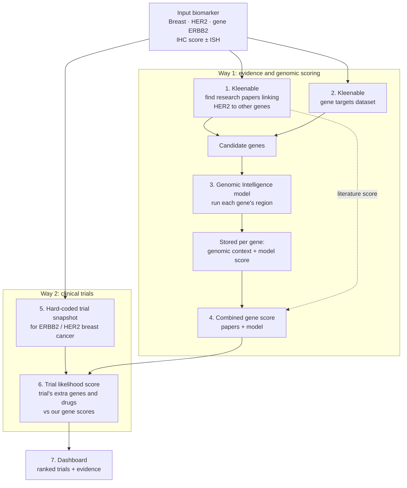
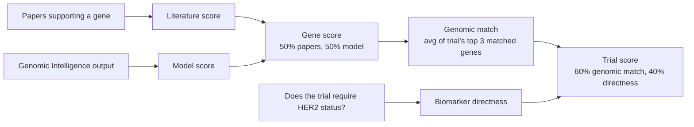
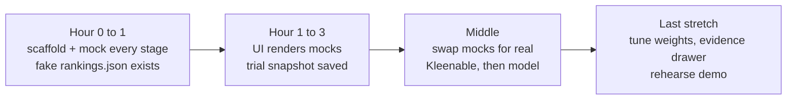

# HUMAN.md

The plan for teammates, in pictures. The detailed spec that coding agents follow is `AGENTS.md`. If you change the plan, change it there too.

## The pitch in one line

Give us a biomarker (HER2 in breast cancer) and we return a ranked list of clinical trials, with the papers and genomic evidence behind every rank.

## How it works

## Why two ways

A trial is almost never about HER2 alone. It adds a second drug, a second target, or extra eligibility genes. Way 1 tells us which genes around HER2 matter most (from papers and from the model). Way 2 uses that to rank trials by how well their "extras" line up with those genes.

## The score, in plain words

Everything is between 0 and 1. The percentages are starting guesses we can tune on demo day.

## What the user sees

One page. A biomarker card on top, then a ranked list of trials. Each row has a score bar and gene chips. Click a row to open the evidence: gene scores and the papers behind them. We borrow the layout style of biomarkershealth.com and clintrialfinder.com (clean ranked cards), built with our own code and branding.

## Who does what

Four lanes that only touch each other through JSON files, so nobody blocks anybody.

| Lane | Owns | Done when | Owner |
|---|---|---|---|
| A. Literature and targets | Kleenable client, stages 1 and 2 | `papers.json` and `gene_candidates.json` hold real results | TBD |
| B. Genomic model | Genomic Intelligence client, stage 3 | `genomic_context.json` has a context and score per gene | TBD |
| C. Trials and scoring | Trial snapshot, stages 4 to 6 | `rankings.json` is sorted and explainable | TBD |
| D. Dashboard | FastAPI endpoints, Next.js UI | Ranked list with evidence drawer runs locally | TBD |

## Order of attack

The rule: something demoable exists from hour one, and it only gets more real.

## Demo script (90 seconds)

1. "HER2 is tested in every one of the 1,290 breast cases in our dataset. Which trial fits?"
2. Show the biomarker card, then the ranked trials.
3. Open the top trial. Point at the gene chips: "these are the genes this trial adds on top of HER2."
4. Open one gene: papers from Kleenable on the left, the Genomic Intelligence score on the right.
5. Close: "one biomarker today, the same pipeline works for any row in the table."

## Decisions we still need

- Kleenable: exact name, docs link, and login. Lane A cannot start real calls without it.
- Which Genomic Intelligence task gives us the "likelihood" number, and what high means.
- Which gene targets dataset we use.
- Are the 50/50 and 60/40 weights fine for the demo.
- Lane owners.

## Ground rules

- No invented data. Anything fake is labeled "mock" in the file and in the UI.
- Keys go in `.env`, never in git.
- It is a research prototype, not medical advice. The UI says so.
