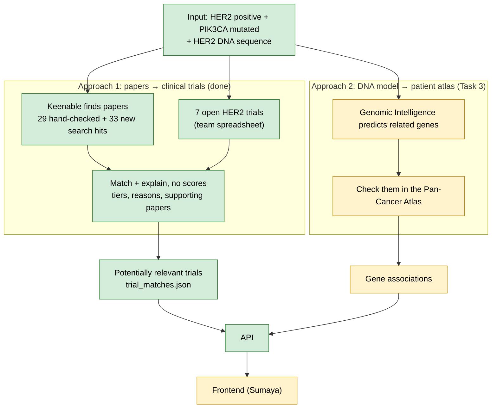

# HUMAN.md: live progress tracker

Plain-language status of the personalized medicine platform. Updated after every milestone. For the overview see [`README.md`](README.md); for the technical spec see [`AGENTS.md`](AGENTS.md).

> **Research prototype. Not medical advice.**

_Last updated: 2026-11-14, end of Task 2. Branch: `platform/personalized-medicine`._

## Progress

- [x] Task 1: Architecture and documentation
- [x] Task 2: Research papers and clinical trial matching
- [ ] Task 3: Genomic intelligence and Pan-Cancer Atlas mapping
- [ ] Task 4: Integration, testing, and functional POC

## Current status

**Approach 1 works end to end.** Starting from the profile (HER2 positive + PIK3CA mutated), the platform searches Keenable for papers, loads the 7 open HER2 trials from the team spreadsheet, and explains, trial by trial, why each one may be relevant, with the papers behind it. There are no scores: trials are grouped into tiers by simple rules. Approach 2 (DNA model → Pan-Cancer Atlas) is next.

## The plan in one picture



Green = built and tested. Yellow = still to build.

## What Approach 1 found (the actual output)

| Tier | Trials | Why |
|---|---|---|
| **1. Requires HER2 positive and PIK3CA mutated** | NCT05894239 (INAVO122), NCT05306041 (GeparPiPPa), NCT05230810 (tucatinib + alpelisib) | Their criteria ask for both biomarkers. Each tests a drug aimed at PIK3CA (inavolisib or alpelisib). |
| **2. Requires HER2 positive, plus related genes** | NCT04569747, NCT07506876, NCT07610720, NCT07612215 | They require HER2 but do not select on PIK3CA. They also require hormone receptor (ER/PR) status, which our papers discuss alongside HER2 and which the profile does not record, so a researcher must check it. |

Every trial comes with the exact criteria line that matched, the drugs it uses and what they target, up to 6 supporting papers (with the total and how many were checked by hand), and a short written explanation. For the three tier-1 trials, 21–24 papers support the extra genes or drugs. Another 14–15 papers are about the same drugs (alpelisib, inavolisib) but in **HER2-negative** disease. Those are listed separately as context, not counted as support.

**Evidence labels.** Paper evidence comes in two kinds: 29 papers checked by hand against PubMed (`reviewed: true`), and 33 new Keenable search hits merged automatically (`reviewed: false`, marked "not yet reviewed"). Every new hit was checked against its PubMed record: the title, year and article type come from PubMed, and its genes are read from the PubMed title and abstract, not from the search page. Trial statuses come from the team spreadsheet (as of 2026-11-14) and must be confirmed on ClinicalTrials.gov.

## Completed (verified)

- **Task 1:** scoring system removed; new input profile; docs rewritten.
- **Keenable search:** the platform builds 5 plain-language queries from the profile ("HER2 positive and PIK3CA mutated breast cancer", "alpelisib in HER2 positive breast cancer", ...), searches PubMed pages through Keenable without a key, checks every hit against PubMed, and merges new papers behind the hand-checked ones. Every query and what happened to each hit is logged; no abstract text is stored.
- **Real trials:** the 7 open trials from the spreadsheet replace the 6 placeholder trials.
- **Keenable CLI:** installed (v0.5.1). Logging in to your account and adding it to Claude Code is waiting on you (two device codes expired); the pipeline does not need it.
- **Trial matching:** reads each trial's criteria for HER2 and PIK3CA (required, mentioned, conflicting or absent), finds drugs and their targets, finds related genes (including "ER/PR/HR" → ESR1/PGR), groups trials into tiers and writes the explanation.
- **API:** `GET /api/trial-matches` serves the result for the frontend.
- **Tests:** 124 offline tests pass, including 114 eligibility phrasings (104 written by an independent reviewer) and every tier.
- **Independent review:** four reviewers checked matching accuracy, evidence integrity against PubMed, code bugs and doc consistency. They found real problems: gene tags taken from search snippets, HER2-negative studies counted as support, and HER2 IHC 0/1+/2+ read as positive. All of them were fixed before this milestone was pushed. On the 7 real trials, every tier was already right.

## Working functionality (you can run this now)

| What | Command | What you see |
|---|---|---|
| Smoke tests | `.venv/bin/python -m pytest tests -q` | all pass |
| The pipeline, from saved data | `.venv/bin/python -m backend.pipeline.run` | 62 papers, 30 genes, 7 real trials, 7 trial matches, DNA model output for 30 genes |
| Trial matching only | `.venv/bin/python -m backend.pipeline.matching` | one line per trial: tier, related genes, drugs, paper count |
| Fresh Keenable search | `.venv/bin/python -m backend.pipeline.literature --refresh` | searches again and merges new hits (network) |
| The API | `.venv/bin/uvicorn backend.app.main:app`, then http://localhost:8000/docs | `/api/trial-matches`, `/api/trials`, `/api/papers`, `/api/profile` |

## In progress

Nothing mid-flight. Waiting for a go-ahead on Task 3.

## Remaining work

- **Task 3:** accept a HER2 DNA file (FASTA); run the Genomic Intelligence models on it; list genes found in the sequence and genes whose model profile resembles ERBB2's; attach the Pan-Cancer Atlas values to each; write `gene_associations.json`.
- **Task 4:** one command that runs both approaches; both results on the API; end-to-end test; final docs with example outputs; update the frontend types for Sumaya.

## Blockers and decisions needed

None blocking. Open decisions:

1. **ER/PR status in the profile?** Five trials require hormone receptor status (a sixth names it for one cohort), which the profile does not include. Adding it would let the platform say "fits" rather than "check this".
2. **Who reviews the 33 new papers?** They are labelled unreviewed; a person could check them and write a one-line summary for each.
3. **Atlas coverage (Task 3):** the atlas table covers 30 genes; genes outside it will show "not in atlas table".

## Next steps

Task 3: FASTA input → Genomic Intelligence (genes found in the sequence + ERBB2-like model profiles) → Pan-Cancer Atlas lookup → `gene_associations.json` → API endpoint → tests → commit and push.

## How to run

```bash
[ -d .venv ] || uv venv --python 3.11 .venv
uv pip install --python .venv/bin/python -r requirements.txt

.venv/bin/python -m pytest tests -q
.venv/bin/python -m backend.pipeline.run
.venv/bin/uvicorn backend.app.main:app        # then open http://localhost:8000/docs
```

No API keys are needed. Everything above runs offline from files saved in the repo, except `literature --refresh`, which searches Keenable.
