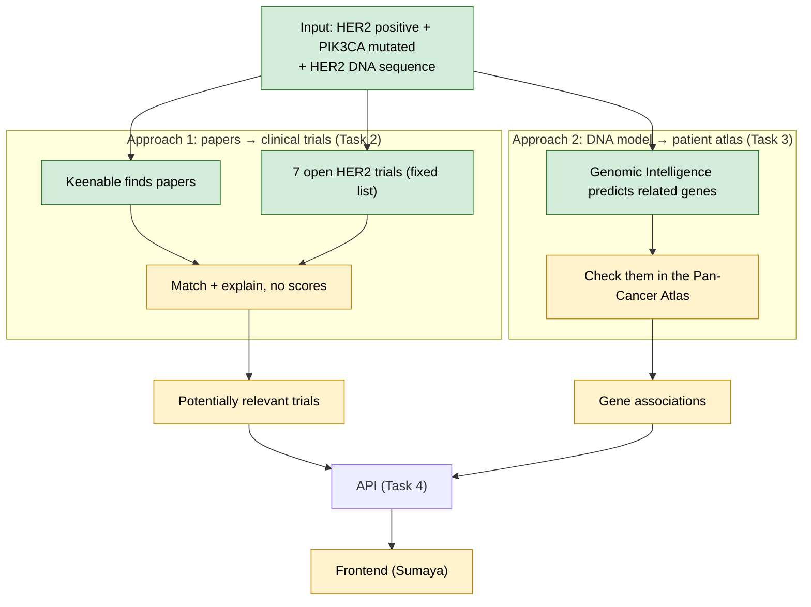

# HUMAN.md: live progress tracker

Plain-language status of the personalized medicine platform. Updated after every milestone. For the overview see [`README.md`](README.md); for the technical spec see [`AGENTS.md`](AGENTS.md).

> **Research prototype. Not medical advice.**

_Last updated: 2026-11-14, end of Task 1. Branch: `platform/personalized-medicine`._

## Progress

- [x] Task 1: Architecture and documentation
- [ ] Task 2: Research papers and clinical trial matching
- [ ] Task 3: Genomic intelligence and Pan-Cancer Atlas mapping
- [ ] Task 4: Integration, testing, and functional POC

## Current status

The project has been re-pointed from "rank trials with a score" to "a research platform with two parallel approaches". The old scoring system is deleted. The new input (HER2 positive + PIK3CA mutated) is in place. The two new result builders (trial matching, atlas mapping) are **not built yet**; that is Tasks 2 and 3.

## The plan in one picture



Green = data or code exists today. Yellow = still to build.

## Completed (verified)

- **Scoring system removed.** The gene scores, trial scores, their weights, files and API endpoints are gone. Tests pass without them (5 of 5).
- **New input.** `data/input/profile.json` describes the profile: HER2 positive and PIK3CA mutated, breast tissue.
- **Pan-Cancer Atlas table is in the working branch** (`pancancer_atlas/her2_dependence_tcga_pancan.csv`, 30 genes).
- **Documentation rewritten:** `AGENTS.md` (the spec), `README.md` (overview), this tracker, all with diagrams.
- **Facts checked in the code before planning:**
  - Keenable has a documented search API that works without a key, so live paper search can be built.
  - Genomic Intelligence has **no "similar DNA sequence" search**. We will produce related genes two ways instead: genes the model finds inside the HER2 sequence, and genes whose model profile resembles ERBB2's.
  - The trials file currently holds 6 placeholder (mock) trials. The 7 real trials are in a spreadsheet and get wired in during Task 2.

## Working functionality (you can run this now)

| What | Command | What you see |
|---|---|---|
| Smoke tests | `.venv/bin/python -m pytest tests -q` | 5 passed |
| The pipeline, from saved data | `.venv/bin/python -m backend.pipeline.run` | 29 real papers, 30 candidate genes, 6 mock trials, DNA model output for 30 genes |
| The input profile | `.venv/bin/python -m backend.pipeline.profile` | HER2 + PIK3CA record |
| The API | `.venv/bin/uvicorn backend.app.main:app` then open http://localhost:8000/docs | `/api/profile`, `/api/papers`, `/api/trials`, `/api/genes`, `/api/genes/ERBB2` |

## In progress

Nothing mid-flight. Task 1 is complete; waiting for a go-ahead on Task 2.

## Remaining work

- **Task 2:** connect Keenable for live paper search on HER2 and PIK3CA; load the 7 real trials from the spreadsheet; match trials to the profile in tiers with a written reason and the supporting papers.
- **Task 3:** accept a HER2 DNA file; run the DNA models; list related genes; attach the Pan-Cancer Atlas values to each.
- **Task 4:** one command that runs both approaches; both results on the API for the frontend; an end-to-end test; final docs with example outputs.

## Blockers and decisions needed

None blocking. Open decisions (defaults in brackets will be used unless told otherwise):

1. **PIK3CA input:** only "mutated: yes", or a specific mutation such as H1047R? [yes/no, with an optional variant field]
2. **Atlas coverage:** the atlas table covers 30 genes. Some genes next to ERBB2 that the model finds (for example MIEN1) are not in it and will show "not in atlas table". [leave as is]
3. **Old experiment:** `poc/compare_glm_vs_keenable.py` compared the model with the literature using the old model summary. [keep, marked as an old experiment]
4. **Frontend types:** `frontend/lib/*.ts` still describes the old API. [update in Task 4, coordinated with Sumaya]

## Next steps

Task 2, in this order: Keenable client → real trials from the spreadsheet → matching and explanations → `data/output/trial_matches.json` and an API endpoint → test → commit and push.

## How to run

```bash
[ -d .venv ] || uv venv --python 3.11 .venv
uv pip install --python .venv/bin/python -r requirements.txt

.venv/bin/python -m pytest tests -q
.venv/bin/python -m backend.pipeline.run
.venv/bin/uvicorn backend.app.main:app        # then open http://localhost:8000/docs
```

No API keys are needed. Everything above runs offline from files saved in the repo.
