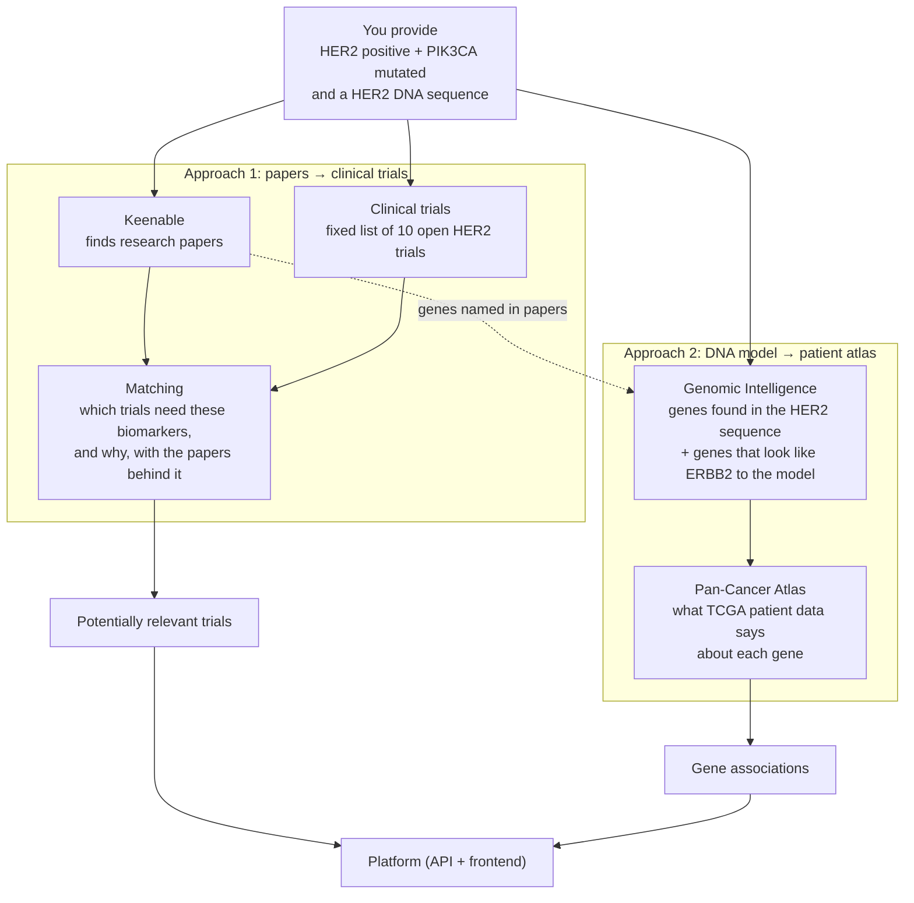

# B5 Hackers: a personalized medicine research platform (proof of concept)

Give the platform a biomarker profile, **HER2 positive + PIK3CA mutated** breast cancer, and it does two things side by side:

1. **Finds research and clinical trials.** It retrieves papers about those biomarkers and matches them to a fixed list of clinical trials, with a plain-language reason for each match.
2. **Finds related genes.** It runs the HER2 DNA sequence through a DNA model (Genomic Intelligence) and checks the predicted genes against TCGA Pan-Cancer Atlas patient data.

> **Research prototype. Not medical advice.** It helps researchers explore; it does not recommend treatment. Following up on the genes it reports is the researcher's job.

**Where are we?** See [`HUMAN.md`](HUMAN.md), the live progress tracker. The detailed spec for coding agents is [`AGENTS.md`](AGENTS.md).

## How it works



The two results are shown separately and never merged into one number. **There is no scoring system**: trials are grouped by simple rules (for example "requires both HER2 and PIK3CA"), not ranked by a score.

## Three kinds of evidence

Every result is labeled with where it came from, so nothing exploratory looks validated.

| Label | What it means | Where it comes from |
|---|---|---|
| **Research-paper evidence** | A published paper reports the link | Keenable search, checked against PubMed |
| **Model prediction** | A DNA model computed it from sequence. Exploratory. | Genomic Intelligence |
| **Dataset-supported association** | Seen in patient cohort data | TCGA Pan-Cancer Atlas (breast cancer) |

Two limits to keep in mind: the DNA models read the reference genome, so they cannot see a patient's own amplification or mutation; and the atlas describes a cohort, not an individual.

## Run it

You need Python 3.11 and [`uv`](https://docs.astral.sh/uv/). Everything runs offline from the committed data; no API keys are needed.

```bash
[ -d .venv ] || uv venv --python 3.11 .venv
uv pip install --python .venv/bin/python -r requirements.txt

.venv/bin/python -m pytest tests -q            # smoke tests
.venv/bin/python -m backend.pipeline.run       # run the pipeline from the caches
.venv/bin/uvicorn backend.app.main:app         # API at http://localhost:8000/docs
```

What each command shows today is listed in [`HUMAN.md`](HUMAN.md).

## What is in this repo

| Path | What it is |
|---|---|
| `README.md` | This page: the overview |
| `HUMAN.md` | Live progress tracker: what works, what is next, how to run it |
| `AGENTS.md` | The spec coding agents follow: file contracts, rules, services. `CLAUDE.md` points to it. |
| `data/input/` | The input profile (`profile.json`), model settings for ERBB2 (`biomarker.json`), drug → target table, clinical words for genes (`gene_terms.json`: ER → ESR1) |
| `data/cache/` | Saved stage outputs, so everything runs offline |
| `data/output/` | The two results: `trial_matches.json` (Approach 1, built) and `gene_associations.json` (Approach 2, being built) |
| `pancancer_atlas/` | TCGA Pan-Cancer Atlas table for 30 genes |
| `clinical_trials/` | Spreadsheet of 10 open HER2 trials (plus notes on excluded ones): the fixed trial list |
| `keenable/` | Literature notes found with Keenable |
| `backend/` | The pipeline (`pipeline/`), one wrapper per outside service (`clients/`), and the API (`app/`) |
| `frontend/` | Owned by Sumaya. Holds API types for the UI. |
| `tests/` | One offline smoke test per stage |
| `poc/`, `lanes/` | Earlier experiments and notes from the first design. Kept for reference. |

## Glossary

| Term | Meaning |
|---|---|
| Biomarker | A measurable feature of a tumor, such as HER2 status or a PIK3CA mutation |
| HER2 / ERBB2 | HER2 is the protein; ERBB2 is the gene that makes it |
| PIK3CA | A gene that is often mutated in breast cancer and is linked to resistance to anti-HER2 drugs |
| Keenable | Web search tool for AI agents, used to find the papers |
| GI | Genomic Intelligence, whose DNA models we call |
| Pan-Cancer Atlas | TCGA's dataset of tumor DNA, RNA and protein measurements from patients |
| Co-amplification | Two genes gaining extra copies together, usually because they sit side by side |
| TSS | Transcription start site, where a gene's RNA begins |
| FASTA | A plain text file format for DNA sequences |

## Ground rules

- **No invented data.** A result is real, or it is labeled `"mock"` in the file and wherever it is shown.
- **No scores.** Trials and genes are grouped and explained, not ranked by a blended number.
- **Keys go in `.env`, never in git.** None are needed to run anything here.
- **Small commits on a branch, then a pull request.**
- It is a research prototype, not medical advice.
