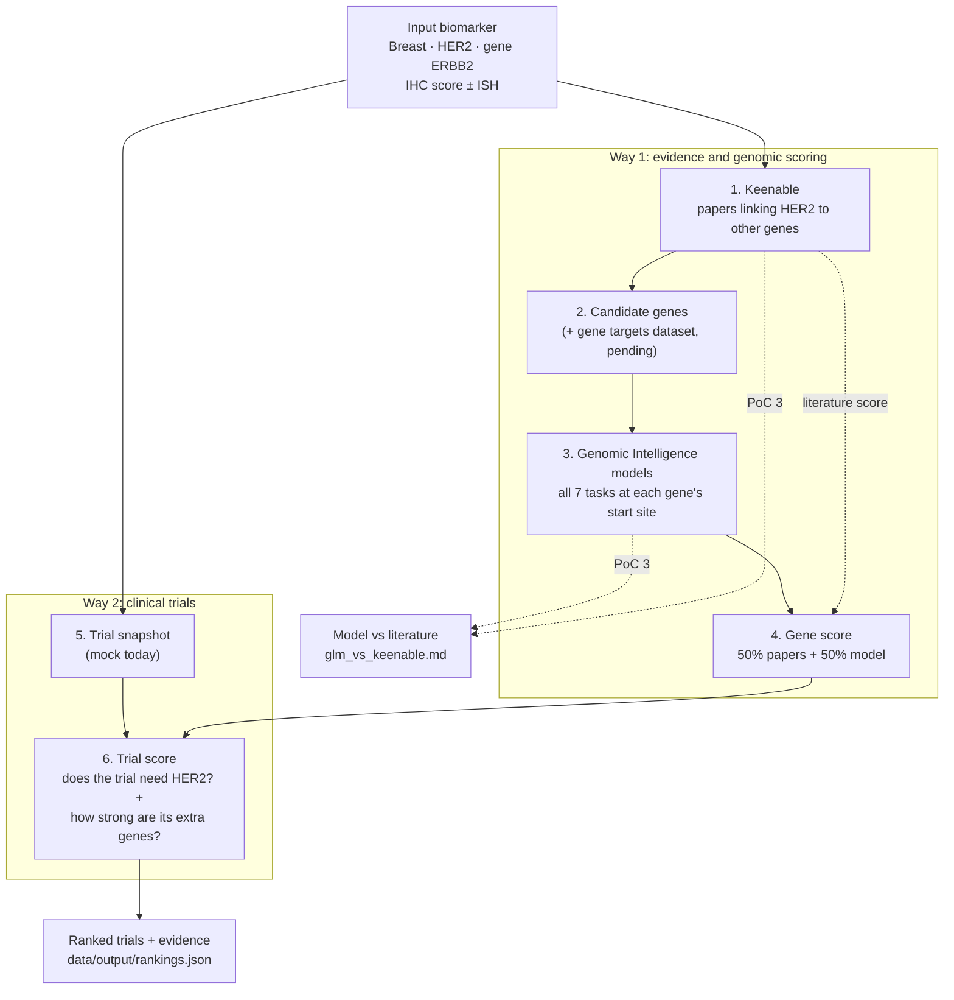

# B5 Hackers: from one biomarker to ranked clinical trials

Give us a biomarker (HER2 in breast cancer) and we return the clinical trials that fit it best, with the papers and the genomic evidence behind every rank.

> **Research prototype. Not medical advice.**

**Current phase: proofs of concept.** We are short on time, so we are **not** building a full app. Each part of the idea gets a small, runnable proof of concept (PoC) that shows it works on real data. The plan below is being revised. `AGENTS.md` is the spec that coding agents follow.

## Start here (5 minutes)

You need Python 3.11 and [`uv`](https://docs.astral.sh/uv/). Everything runs offline from the committed data; no API keys are needed.

```bash
uv venv --python 3.11 .venv
uv pip install --python .venv/bin/python -r requirements.txt

.venv/bin/python -m pytest tests -q                      # 6 smoke tests, should all pass
.venv/bin/python -m backend.pipeline.run --from-stage 4  # rebuild gene scores + trial ranking from the caches
.venv/bin/python poc/compare_glm_vs_keenable.py          # PoC 3: model vs literature
```

## Proofs of concept

| # | Question | Status | Run it | Look at |
|---|---|---|---|---|
| 1 | Can **Keenable** find genes linked to HER2 in the literature? | **Papers real; gene list labeled mock.** 29 PubMed-checked papers name 30 genes. `gene_candidates.json` is tagged mock because the gene targets dataset is still a stand-in. 26 papers have lab evidence: 21 of the 29, plus 5 new ones not yet in `papers.json`. | Curated by hand with Keenable, checked against PubMed | [`keenable/`](keenable/), `data/cache/papers.json` |
| 2 | Can a **genomic language model** (Genomic Intelligence) score those genes? | **Done, real data.** All 7 GI tasks for all 30 genes | `.venv/bin/python -m backend.pipeline.genomic --offline` | [`lanes/B-genomic/README.md`](lanes/B-genomic/README.md), `data/cache/genomic_context.json` |
| 2b | Does the model "see" the HER2 amplicon? | **Done.** Its gene finder puts start sites within 1–21 bp of the real ERBB2, GRB7, PGAP3 and MIEN1 start sites. | `.venv/bin/python -m backend.pipeline.genomic --amplicon` | `data/cache/amplicon_context.json` |
| 3 | Does the model **agree with the literature**? | **Done, first result:** barely (rank correlation about 0), so the two are complementary signals | `.venv/bin/python poc/compare_glm_vs_keenable.py` | [`data/output/glm_vs_keenable.md`](data/output/glm_vs_keenable.md) |
| 4 | Can we **rank trials** by the genes they add on top of HER2? | **Works, but on 6 mock trials,** and the gene list is still tagged mock. | `.venv/bin/python -m backend.pipeline.run --from-stage 4` | `data/output/rankings.json` |
| 5 | Can the results feed a UI? | **API only.** The web page is parked. | `.venv/bin/uvicorn backend.app.main:app` | http://localhost:8000/api/rankings |

"Mock" always means labeled placeholder data (`"source": "mock"`, IDs like `MOCK-NCT-0001`). Nothing is invented and presented as real.

## What is in this repo

| Path | What it is |
|---|---|
| `README.md` | This page: the plan for people (formerly `HUMAN.md`) |
| `AGENTS.md` | The detailed spec for coding agents: contracts, scoring formulas, rules. `CLAUDE.md` just points to it. |
| `keenable/` | Literature notes from Keenable: all HER2 interactors, and a lab-evidence list (21 of the 29 papers plus 5 new ones) |
| `clinical_trials/` | Trial material, including a spreadsheet of 7 open HER2 trials that is not yet in the pipeline |
| `poc/` | Quick proof-of-concept scripts. Each one reads committed data and writes to `data/output/`. |
| `backend/` | The pipeline: `config.py` (all weights), `schemas.py` (file contracts), `clients/` (one wrapper per outside service), `pipeline/` (one module per stage), `app/` (API) |
| `data/input/` | The biomarker record and the drug → target table |
| `data/cache/` | Stage outputs, committed so everything runs offline |
| `data/output/` | Final results: `rankings.json`, `glm_vs_keenable.*` |
| `lanes/` | One folder per workstream, with scope, status and hand-offs. Start at [`lanes/README.md`](lanes/README.md). |
| `tests/` | One offline smoke test per stage |
| `frontend/` | **Parked.** The spec and TypeScript types for a web page we are not building in this phase |

## How the pieces fit (current plan, being revised)



**Why two ways:** a trial is almost never about HER2 alone. It adds a second drug, a second target, or extra eligibility genes. Way 1 says which genes around HER2 matter most, from both papers and the genome model. Way 2 ranks trials by how well their extras line up with those genes. HER2 itself is left out of that match, because every trial has it.

**The scores, in plain words** (all between 0 and 1; weights in `backend/config.py`):

- **Literature score:** how many papers support the gene. 5 or more papers gives 1.0.
- **Model score:** the average of 7 Genomic Intelligence readouts at the gene's start site:
  - expression in HER2+ breast cells, and how breast-specific it is compared with liver
  - promoter strength
  - open chromatin in breast cell lines
  - enhancer activity
  - recovered splice sites
  - gene-finder confidence
  - expression via gene finding
- **Gene score:** 50% literature + 50% model.
- **Trial score:** 40% "does the trial require HER2 status?" + 60% "average gene score of its top 3 extra genes".

To change a weight: for `W_LIT`, `W_MODEL`, `W_DIRECT` or `W_GENOMIC`, re-run `.venv/bin/python -m backend.pipeline.run --from-stage 4`. A Genomic Intelligence task weight (`W_GI_TASK`, `W_EXPR_*`) is applied in stage 3, so run `rm data/cache/genomic_context.json && .venv/bin/python -m backend.pipeline.genomic --offline` first. That uses the per-gene caches, so no network is needed.

## Who does what

Four lanes that only touch each other through JSON files, so nobody blocks anybody. Details are in [`lanes/`](lanes/README.md).

| Lane | Owns | Status | Owner |
|---|---|---|---|
| A. Literature and targets | Keenable client, stages 1–2 | Papers real. The Keenable API and the targets dataset are pending. | TBD |
| B. Genomic model | Genomic Intelligence client, stage 3, PoCs 2 and 3 | Done for 30/30 genes | Contactashmeetsingh |
| C. Trials and scoring | Trial snapshot, stages 4–6 | Scoring done. Trials are still mock. | TBD |
| D. Dashboard | API, web page | API done. Web page parked for the PoC phase. | TBD |

## Next steps (PoC phase)

1. **Real trials (lane C):** convert `clinical_trials/her2_candidate_marker_open_trials.xlsx` into `data/cache/trials.json`, or run `.venv/bin/python -m backend.pipeline.trials --refresh`. That makes the trials real. Rankings stay tagged mock (`mock_inputs: ["gene_candidates"]`) until lane A replaces the targets-dataset stand-in.
2. **Lab-evidence papers into the pipeline (lane A):** move the 26 lab-evidence papers (including the 5 not yet in `papers.json`) from `keenable/her2_interactors_experimental.md` into a data file, so scoring and PoC 3 read it directly.
3. **Per-task model scores on each ranked trial (lanes B and C):** show which Genomic Intelligence task drove a trial's rank.
4. Revise this plan for the PoC phase and assign lane owners.

## Decisions we still need

- Keenable API access, and which gene targets dataset to use (lane A cannot make live calls without them)
- Weights: are 50/50 (papers vs model) and 40/60 (HER2 requirement vs extra genes) fine?
- Keep the enhancer task in the model score? Its model was trained on fruit-fly DNA.
- Lane owners for A, C and D

## Ground rules

- **No invented data.** A result is real, or it is labeled `"mock"` in the file and wherever it is shown.
- **Keys go in `.env`, never in git.** See `.env.example`. None are needed to run anything here.
- **Small commits on a branch, then a pull request.** If you change a file contract, update `AGENTS.md` section 4 in the same commit.
- It is a research prototype, not medical advice.
