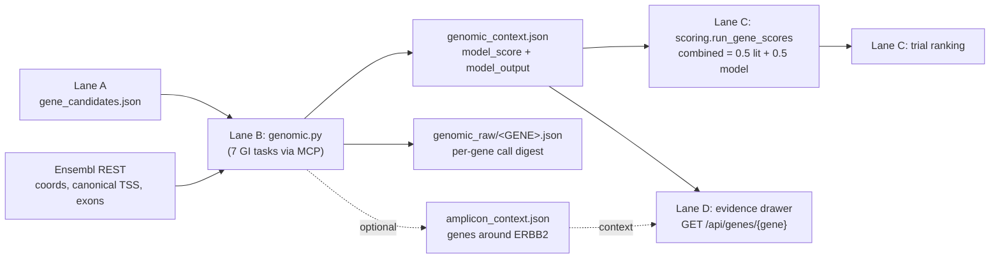

> **Architecture v1 notes (historical).** On 2026-11-14 the project moved to architecture v2: two approaches (papers → trial matching, DNA model → Pan-Cancer Atlas) and **no scoring system**. Stage numbers, `scoring.py`, `gene_scores.json` and `rankings.json` mentioned below no longer exist. `AGENTS.md` is the source of truth and `HUMAN.md` tracks progress.

# Lane B: Genomic model (stage 3)

**Owner:** Contactashmeetsingh

**Status, 2026-11-14:**
- **Done:** all 7 GI tasks (v1) on real model output, 30/30 genes, 0 mocks. The tasks are expression, find genes + expression, promoter, chromatin, enhancer, splice and annotation. The committed `genomic_context.json` and today's `rankings.json` are built from it.
- **Done:** GI vs Keenable comparison, as PoC 3 (`poc/compare_glm_vs_keenable.py` → `data/output/glm_vs_keenable.md`). There is no significant agreement (rho −0.20 to 0.12, n = 29). The two may be complementary, but this test can't show it.
- **Next:** add per-task scores to the ranking rows.

Lane B asks the Genomic Intelligence (GI) DNA language models what the genome says about each candidate gene, and turns the answers into a `model_score` in [0, 1]. Stage 4 blends that score 50/50 with the literature (Keenable) evidence.

*Terms:* TSS = transcription start site, where a gene's RNA begins. MCP = Model Context Protocol, the API style GI's hosted server uses. minmax = rescale across the 30 genes so the lowest is 0 and the highest 1. log(TPM+1) = predicted expression in transcripts per million, log-scaled.

## How it fits the system



| | |
|---|---|
| Reads | `data/cache/gene_candidates.json` (lane A), `data/input/biomarker.json` (`model_context` block) |
| Writes | `data/cache/genomic_context.json` (contract in `AGENTS.md` §4) |
| Also writes | `data/cache/genomic_raw/<GENE>.json`, `data/cache/amplicon_context.json`, `data/cache/ensembl_genes.json` |
| Files owned | `backend/clients/genomic_intelligence.py`, `backend/clients/ensembl.py`, `backend/pipeline/genomic.py`, `tests/test_genomic.py`, this folder |
| Consumed by | Lane C uses `model_score`. Lane D shows `model_output`. |

**Hand-off rules for the other lanes**

- **Lane A:** add or remove genes in `gene_candidates.json`, then re-run stage 3. Only uncached genes and tasks are sent to GI. Old HGNC symbols are fine (`SLC9A3R1` resolves to `NHERF1`).
- **Lane C:** read only `gene`, `model_score` and `source`. `model_score` is `null` on mock rows, so treat it as 0.0. Per-task scores are in `model_output.task_scores` (v1) if you want to show them.
- **Lane D:** everything the evidence drawer needs is in `model_output` (shape below). Show a "mock data" tag when `source == "mock"`. Per-task scores are in `model_output.task_scores` (7 keys, each [0,1] or null).
- **New biomarker:** add a row with its own `model_context`. No code change is needed.

## Run it

```bash
.venv/bin/python -m backend.pipeline.genomic             # cache first; only uncached genes/tasks hit the network
.venv/bin/python -m backend.pipeline.genomic --refresh   # re-query GI for every gene and task
.venv/bin/python -m backend.pipeline.genomic --offline   # never call the network; genes without complete output become mock rows
.venv/bin/python -m backend.pipeline.genomic --amplicon  # also scan ERBB2 ± 100 kb (context only)
.venv/bin/python -m pytest tests/test_genomic.py -q      # offline smoke test
.venv/bin/python lanes/B-genomic/sanity_check.py         # biology sanity checks -> sanity_check.json
```

No key is needed. The hosted MCP server at `https://mcp.genomicintelligence.ai/mcp` answers on a shared demo key, which has shared rate limits and is for evaluation only. Put `GI_API_KEY=gi_...` in `.env` to use your own key on the same server; to request one, email contact@genomicintelligence.ai. The v1 run is slow on the demo key: about 30–60 s per gene, mostly the gene finder. `GI_WORKERS` in `config.py` sets how many genes run in parallel.

## What the model is asked, per gene (v1: every GI task)

Everything is anchored on the gene's canonical transcription start site (TSS). The TSS comes from Ensembl and is cross-checked against GI (`locus.tss_matches_ensembl`).

| Task (model) | Input | Readout | Task score |
|---|---|---|---|
| **expression** (`g0-expression-8192`) | GI's TSS-centred 81,920 bp, gene-sense | log(TPM+1) with description `"HER2-positive breast cancer cell line"`, and specificity = that minus the `"liver tissue"` prediction | 0.5 × minmax(level) + 0.5 × minmax(specificity) |
| **composite** (find genes + expression) | TSS ± 40 kb, plus strand | expression of the transcript the gene finder itself places at the canonical TSS | minmax; none if the finder misses the TSS |
| **promoter** (`g0-promoter-2000bp`) | TSS ± 1 kb, gene-sense | max promoter probability | as-is (a probability) |
| **chromatin** (`g0-deepsea`) | TSS ± 1 kb | DeepSEA features called (≥ 0.5) in breast-lineage cells (HMEC, MCF-7, T-47D) | minmax |
| **enhancer** (`g0-deepstarr`) | TSS ± 1 kb, gene-sense | peak developmental/housekeeping activity | minmax. **Caveat:** this model is trained on fruit-fly DNA. To drop it, set its weight in `W_GI_TASK` to 0, then run `rm data/cache/genomic_context.json && .venv/bin/python -m backend.pipeline.genomic --offline && .venv/bin/python -m backend.pipeline.run --from-stage 4`. Task weights are applied in stage 3. |
| **splice** (`g0-splice-bigbird`) | TSS → TSS + 15 kb, gene-sense | share of the canonical transcript's splice sites (donors and acceptors, from Ensembl exons) that the model calls within 10 bp | as-is (a fraction); none if the window has no splice site |
| **annotation** (`g0-annotation`) | TSS ± 40 kb, plus strand | confidence of the transcript the gene finder places within 1 kb of the canonical TSS | as-is (a probability); 0 if the finder misses the gene |

```
model_score = weighted mean of the task scores the gene has     (W_GI_TASK in config.py, 1.0 each)
```

Probabilities and fractions are used as-is. Unbounded readouts are min-max normalised across the candidate set. A task with no readout for a gene, such as splice on a single-exon gene, is left out of that gene's mean rather than counted as 0. The weights and windows live in `backend/config.py` (`W_GI_TASK`, `W_EXPR_*`, `GI_*_BP`). The context strings live in `data/input/biomarker.json` → `model_context`.

**In one sentence for judges:** a gene scores high when the DNA models agree it looks like a well-formed, active gene in HER2-positive breast cells. That means expressed (more than in liver), with an open promoter and enhancer-like activity at its start site, and a structure the splice and gene-finder models recognise.

### v0 (superseded)

The first run scored three components: expression and specificity (as above), and regulatory = 0.5 × promoter + 0.5 × minmax(chromatin). v1 replaced it. The v0 numbers are still in each gene's `genomic_raw` digest.

### Model ids are resolved, not hard-coded

Each run asks GI for every task's current `default_model` and passes it on every call, so a run never straddles a default change. The ids are recorded in `model_output.models` and in `model_task`.

## `model_output` shape (v1, what lane D can render)

```jsonc
{
  "summary": "one sentence with the key numbers",
  "task_scores": { "expression": 0.0, "composite": 0.0, "promoter": 0.0, "chromatin": 0.0,
                   "enhancer": 0.0, "splice": 0.0, "annotation": 0.0 },          // [0,1] or null
  "task_raw":    { "expression_level": 0.0, "expression_specificity": 0.0, "composite": 0.0, "promoter": 0.0,
                   "chromatin": 0, "enhancer": 0.0, "splice": 0.0, "annotation": 0.0 },
  "tasks_used": ["..."], "weights": { "task.expression": 1.0, "...": 1.0 },
  "locus": { "ensembl_id", "chrom", "strand", "tss", "tss_source", "tss_matches_ensembl",
             "expression_window", "tss_window", "splice_window", "annotation_window" },
  "expression": { "target": { "description", "log_tpm", "tpm", "scored_window", "request_id" }, "reference": { "..." } },
  "composite":  { "description", "genes_found", "found_at_tss", "log_tpm", "distance_to_canonical_tss_bp", "request_id" },
  "promoter":   { "max_probability", "upstream_window_probability", "request_id" },
  "chromatin":  { "threshold", "on_tissue_cell_types", "on_tissue_labels_called", "on_tissue_by_feature", "top_on_tissue_calls", "request_id" },
  "enhancer":   { "dev_score_max", "hk_score_max", "dev_score_mean", "hk_score_mean", "request_id" },
  "splice":     { "junctions_in_window", "junctions_recovered", "recall", "sites_called", "precision", "request_id" },
  "annotation": { "transcripts_found", "found_at_tss", "confidence", "transcript_type", "distance_to_canonical_tss_bp", "request_id" },
  "models": { "expression": "g0-expression-8192", "...": "..." }, "retrieved": "2026-11-14", "demo_key": true
}
```

A mock row has `source: "mock"`, `model_score: null` and `model_output: {"error": "..."}`. No number is ever invented. Every real number carries the GI `request_id` that produced it.

## Evidence that the signal behaves like biology

From `sanity_check.json` and the runs so far, all on 2026-11-14 on the demo key. These are checks for the demo story, not a validation of the method.

- **Tissue control, mostly works:** ALB (a liver gene) scores 9.69 in "liver tissue" vs 0.52 in the HER2+ breast context. ERBB2 scores 3.17 vs 1.87. HBB (blood, which liver tissue contains) scores 3.53 vs 0.74. The housekeeping control did not behave: GAPDH scores 4.42 in breast but only 1.67 in liver.
- **Deterministic:** the same request twice gives the same value (ERBB2: 3.168 and 3.168).
- **Strand check (6 of the 12 minus-strand genes tested):** in 5, the gene-sense TSS window scores higher than its reverse complement. The margin is clear for SHC1 (0.92 vs 0.34) and PGAP3, and narrow for HSP90AA1 and STAT3. JUN is the exception.
- **The splice model recovers real splice sites:** for ERBB2, all 17 canonical splice sites (9 donors, 8 acceptors) in the first 15 kb were called, with no extra calls. Among the 12 genes with 5 or more sites in the window, 10 had every site recovered (ITGB4 28/29, STUB1 11/12). For 13 genes the window holds only the exon-1 donor, so their score is 1 of 1. IGF1R's single site was missed. JUN is single-exon.
- **The gene finder places the known genes around ERBB2** (`amplicon_context.json`, ERBB2 ± 100 kb). This runs on the reference genome, so it is gene annotation, not copy number. It made 9 calls; one is a duplicate. 4 land within 1–21 bp of the ERBB2, GRB7, PGAP3 and MIEN1 start sites, and 2 within 600 bp of TCAP and PNMT. Two more are 0.4 and 4.4 kb from GRB7. It missed STARD3, NEUROD2 and PPP1R1B. It does find STARD3, 4 bp off, in STARD3's own window.
- **The gene finder is gene-dependent.** It finds ERBB2, GRB7 and HSP90AA1 with high confidence, but misses STAT3, EZR and PIK3CA in their ± 40 kb windows. A window spanning the whole transcript did no better on 5 test genes; that was an exploratory run during development and is not saved. Read a low annotation score as "the model did not recognise this locus", not as biology. Across all 30 genes, it placed a transcript within 1 kb of the canonical TSS for 19, and 14 of those calls have confidence above 0.5.
- **Description wording matters.** In exploratory runs that were not saved, bare cell-line names gave unreliable numbers: `"MCF-7"` gave ESR1 about 0.16, which is wrong for an ER+ line. We use full phrases and keep them fixed across runs, as GI's docs advise.

## Known limits (say these out loud if asked)

- The models read the **reference genome**. They score a gene's baseline regulatory potential in a context, not a patient's tumour. They cannot see HER2 amplification or copy number.
- Context strings are free text that conditions the model, not a controlled vocabulary. A different wording gives different numbers. Compare only runs that use the same strings.
- The enhancer model is *Drosophila*-trained (DeepSTARR). Its human scores are relative signal at best.
- The absolute values are noisy. GAPDH, a housekeeping gene, scores 1.67 in "liver tissue". Read scores as relative, within this candidate set.
- The demo key shares quota with other evaluators. If it rate-limits, the client backs off and retries. Persistent failure produces mock rows and the run continues.
- Min-max normalisation is relative to the current candidate set, so adding genes can shift every score.

## Status

- [x] GI client over hosted MCP (session handling, retries on GI's transient error codes, optional key)
- [x] Ensembl client (symbol → ID, coordinates, canonical TSS, exons, old-symbol fallback)
- [x] v0: stage 3 on real model output for all 30 literature genes (expression, promoter, chromatin)
- [x] v1 code: all 7 GI tasks, per-task scores, per-gene and per-task cache, parallel workers, smoke test updated
- [x] Optional amplicon scan around the biomarker gene, labelled with Ensembl genes
- [x] Biology sanity checks (`sanity_check.py`)
- [x] **v1 full run:** 30/30 genes with all 7 tasks, committed, and stages 4–6 re-run
- [ ] **Per-task scores in the ranking:** add `model_task_scores` to `gene_scores.json` and `matched_genes`, plus a per-trial breakdown of which task drove `genomic_match`. This touches lane C's `scoring.py` and `backend/schemas.py`, so agree it with lane C.
- [x] **Compare GI with Keenable** (PoC 3): `poc/compare_glm_vs_keenable.py` writes `data/output/glm_vs_keenable.{json,md}`, with the Spearman correlation overall and per task and the agreement quadrants. There is no API endpoint, because the UI is parked.
- [ ] Get our own `GI_API_KEY` for private quota (same code path)
- [ ] Decide with the team whether `"liver tissue"` is the best reference context, and whether to keep the enhancer task
- [ ] Later: GI's `genomic-variant-interpretation` workflow scores patient VCF variants near TSSs. It is REST-only and not finished on GI's side, but it is the path from "reference genome" to "this patient".
