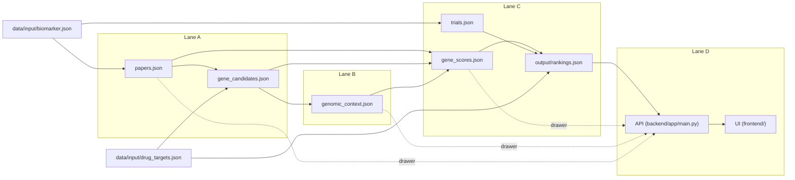

# Lanes

## Where we are (2026-11-14)

**The pipeline runs end to end.** `python -m backend.pipeline.run` takes the HER2 biomarker through papers, gene candidates, Genomic Intelligence scores, gene scores and trials to `data/output/rankings.json`. It is served by `uvicorn backend.app.main:app`. Today's ranking is **not demo-ready yet**: the trials are a 6-row mock and the targets dataset is a stand-in. Every mocked row is tagged as mock.

| Stage | File | Real or mock |
|---|---|---|
| 1 Literature | `papers.json` | **Real.** 29 PubMed-verified papers found with Keenable |
| 2 Gene targets | `gene_candidates.json` | Genes and paper links are real. Rows are tagged mock because the Keenable targets dataset is not hooked up yet. |
| 3 Genomic context | `genomic_context.json` | **Real.** All 7 GI tasks for 30/30 genes, 0 mocks |
| 4 Gene scores | `gene_scores.json` | Computed from 1–3 |
| 5 Trials | `trials.json` | **Mock** (6 trials `MOCK-NCT-0001…6`). The ClinicalTrials.gov client is ready; run `trials --refresh` to take the real snapshot. |
| 6 Rankings | `rankings.json` | Computed; every row carries `mock_inputs` |
| 7 Dashboard | API | The API works and is tested. The Next.js UI is not started. |

**Biggest open items, in priority order**

1. **Lane C: replace the mock trials.** Until then every ranking row is mock. Two ways: run `trials --refresh` (ClinicalTrials.gov snapshot, about 200 studies), or convert `clinical_trials/her2_candidate_marker_open_trials.xlsx` into `trials.json`. That spreadsheet, merged in #3, lists 7 real open HER2 trials with PIK3CA/ESR1/PGR markers, which is the kind of trial our genomic match should rank well.
2. **Lane D: build the Next.js page.** The types, fetch helpers and spec are in `frontend/`.
3. **Lane B: add per-task GI scores to the ranking,** and compare the GI ranking with the Keenable literature evidence. The 7-task run itself is done.
4. **Lane A: Keenable docs and auth,** the real targets dataset, and a follow-up search for CDK12, TOP2A and TP53.
5. **Team decisions:** owners for A, C and D; the weights (0.5/0.5 and 0.4/0.6); whether to keep the fly-trained enhancer model in the GI score; "liver tissue" as the reference context.

**Quick start**

```bash
uv venv --python 3.11 .venv && uv pip install --python .venv/bin/python -r requirements.txt
.venv/bin/python -m backend.pipeline.run --from-stage 4   # rebuild scores + rankings from the committed caches (offline)
.venv/bin/python -m pytest tests -q                        # 6 offline smoke tests
.venv/bin/uvicorn backend.app.main:app --reload            # API on http://localhost:8000/api/rankings
```

## The lanes

The four workstreams from `README.md` (formerly `HUMAN.md`). Each lane owns its stage modules and its output files. Lanes talk to each other **only through the JSON contract files** in `data/`. Nobody imports another lane's pipeline code or edits another lane's output. `AGENTS.md` is ground truth; this folder only says who does what.

| Lane | Owns | Stage(s) | Reads | Writes | Status | Owner |
|---|---|---|---|---|---|---|
| [A. Literature and targets](A-literature/README.md) | `backend/clients/keenable.py`, `backend/pipeline/literature.py`, `backend/pipeline/targets.py` | 1, 2 | `biomarker.json`, `drug_targets.json` | `papers.json`, `gene_candidates.json` | `papers.json` is real (29 papers). `gene_candidates.json` is built, but marked mock until the real targets dataset lands. The Keenable client is a placeholder. | TBD |
| [B. Genomic model](B-genomic/README.md) | `backend/clients/genomic_intelligence.py`, `backend/pipeline/genomic.py` | 3 | `gene_candidates.json`, `biomarker.json` (`model_context`), Ensembl cache | `genomic_context.json`, `genomic_raw/` | Real: all 7 GI tasks for 30/30 genes. Next: per-task scores in the ranking, and the GI vs Keenable comparison. | Contactashmeetsingh |
| [C. Trials and scoring](C-trials-scoring/README.md) | `backend/pipeline/trials.py`, `backend/pipeline/scoring.py` | 4, 5, 6 | `papers.json`, `gene_candidates.json`, `genomic_context.json`, `drug_targets.json`, `biomarker.json` | `gene_scores.json`, `trials.json`, `rankings.json` | Scoring done and tested. The ClinicalTrials.gov client is ready. `trials.json` is still mock: the real snapshot has not been taken. | TBD |
| [D. Dashboard](D-dashboard/README.md) | `backend/app/main.py`, `frontend/` | 7 | `rankings.json` and every cache | nothing (serves the API and the UI) | API done, UI to do | TBD |

Shared by everyone, changed only by agreement: `AGENTS.md`, `backend/config.py` (paths and weights), `backend/schemas.py` (the contracts), `backend/store.py` (read and write), `backend/pipeline/biomarker.py` (stage 0). If you change a schema, update `AGENTS.md` section 4 in the same commit.

## Hand-offs



The main line is `papers.json` → `gene_candidates.json` → `genomic_context.json` → `gene_scores.json` + `trials.json` → `rankings.json` → API → UI. The dotted lines are the extra files the evidence drawer reads to show the genes and papers behind a rank.

## Rules every lane keeps

- **Only the files talk.** A lane reads another lane's output through `backend.store.read_rows(path, Model)` and never calls its code. Until an upstream file exists, write a clearly labeled mock with the right schema.
- **Mocks look like mocks.** Use `"source": "mock"` and IDs that cannot pass for real ones (`MOCK-NCT-0001`, `MOCK-PAPER-001`). Stage 6 lists mocked inputs in `rankings[].mock_inputs`, and the UI tags them.
- **Cache first.** Each stage runs alone (`python -m backend.pipeline.<stage>`) and only uses the network with `--refresh`. `python -m backend.pipeline.run` runs them all.
- **No fabricated data**, one smoke test per stage, and keys only in `.env` (`AGENTS.md` section 10).
