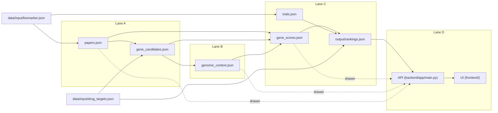

# Lanes

For where the project stands, the proofs of concept and the next steps, see the [top-level README](../README.md). This page is the lane detail: who owns which files, and how lanes hand off to each other.

## The lanes

The four workstreams from `README.md` (formerly `HUMAN.md`). Each lane owns its stage modules and its output files. Lanes talk to each other **only through the JSON contract files** in `data/`. Nobody imports another lane's pipeline code or edits another lane's output. `AGENTS.md` is ground truth; this folder only says who does what.

| Lane | Owns | Stage(s) | Reads | Writes | Status | Owner |
|---|---|---|---|---|---|---|
| [A. Literature and targets](A-literature/README.md) | `backend/clients/keenable.py`, `backend/pipeline/literature.py`, `backend/pipeline/targets.py` | 1, 2 | `biomarker.json`, `drug_targets.json` | `papers.json`, `gene_candidates.json` | `papers.json` is real (29 papers). `gene_candidates.json` is built, but marked mock until the real targets dataset lands. The Keenable client is a placeholder. | TBD |
| [B. Genomic model](B-genomic/README.md) | `backend/clients/genomic_intelligence.py`, `backend/clients/ensembl.py`, `backend/pipeline/genomic.py`, `poc/compare_glm_vs_keenable.py` | 3 | `gene_candidates.json`, `biomarker.json` (`model_context`), Ensembl cache | `genomic_context.json`, `genomic_raw/` | Real: all 7 GI tasks for 30/30 genes. The GI vs Keenable comparison is done as PoC 3 (`poc/`). Next: per-task scores in the ranking. | Contactashmeetsingh |
| [C. Trials and scoring](C-trials-scoring/README.md) | `backend/clients/clinicaltrials.py`, `backend/pipeline/trials.py`, `backend/pipeline/scoring.py`, `backend/pipeline/run.py` | 4, 5, 6 | `papers.json`, `gene_candidates.json`, `genomic_context.json`, `drug_targets.json`, `biomarker.json` | `gene_scores.json`, `trials.json`, `rankings.json` | Scoring done and tested. The ClinicalTrials.gov client is ready. `trials.json` is still mock: the real snapshot has not been taken. | TBD |
| [D. Dashboard](D-dashboard/README.md) | `backend/app/main.py`, `frontend/` | 7 | `rankings.json` and every cache | nothing (serves the API and the UI) | API done. Web page **parked** for the proof-of-concept phase. | TBD |

Shared by everyone, changed only by agreement: `AGENTS.md`, `backend/config.py` (paths and weights), `backend/schemas.py` (the contracts), `backend/store.py` (read and write), `backend/pipeline/biomarker.py` (stage 0). If you change a schema, update `AGENTS.md` section 4 in the same commit.

## Hand-offs

The main line is `papers.json` → `gene_candidates.json` → `genomic_context.json` → `gene_scores.json` + `trials.json` → `rankings.json` → API → UI. The dotted lines are the extra files the evidence drawer reads to show the genes and papers behind a rank.

## Rules every lane keeps

- **Only the files talk.** A lane reads another lane's output through `backend.store.read_rows(path, Model)` and never calls its code. Until an upstream file exists, write a clearly labeled mock with the right schema.
- **Mocks look like mocks.** Use `"source": "mock"` and IDs that cannot pass for real ones (`MOCK-NCT-0001`, `MOCK-PAPER-001`). Stage 6 lists mocked inputs in `rankings[].mock_inputs`, and the UI tags them.
- **Cache first.** Each stage runs alone (`python -m backend.pipeline.<stage>`) and only uses the network with `--refresh`. `python -m backend.pipeline.run` runs them all.
- **No fabricated data**, one smoke test per stage, and keys only in `.env` (`AGENTS.md` section 10).
