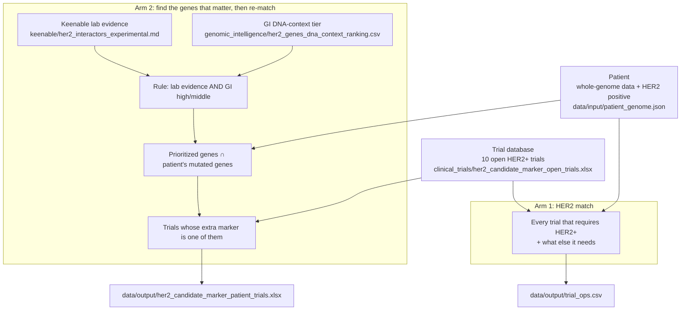

# Two-arm workflow: HER2+ patient genome → better-matched clinical trials

> Research prototype. Not medical advice. The demo patient is synthetic.

## The idea in plain words

A patient arrives with **whole-genome data** and a **HER2-positive** tumor.

- **Arm 1** asks: *which trials accept a HER2+ patient?* Every HER2+ trial is a possible fit, but many also need something extra, such as a PIK3CA mutation or ER/PR status.
- **Arm 2** asks: *which of the patient's other genes matter alongside HER2?* It keeps a gene only if **lab papers (Keenable)** link it to HER2 **and** the **DNA model (Genomic Intelligence)** puts it in the high or middle tier. If the patient's genome has that gene mutated, we go back to the trial database and pull out the trials built around it. Those trials fit **better** than HER2 alone.

**Example.** The genome shows 5 mutations: PIK3CA, TP53, GATA3, MAP3K1 and CDH1. Arm 2 keeps only **PIK3CA**, which has lab evidence and is GI high tier. Of the 10 HER2+ trials from arm 1, the 4 PIK3CA trials become the better match.



## Run it

```bash
.venv/bin/python -m workflows.wgs_two_arm.run                                              # default patient: genome = ERBB2 only
.venv/bin/python -m workflows.wgs_two_arm.run --mutated-genes PIK3CA TP53 GATA3 MAP3K1 CDH1   # the 5-mutation example
.venv/bin/python -m pytest tests/test_wgs_two_arm.py -q
```

Everything runs offline from files in the repo. No API keys are needed.

## Inputs

| File | Role |
|---|---|
| `data/input/patient_genome.json` | The patient: `her2_status` and `genome.mutated_genes`. For now the genome is a list of gene names (`["ERBB2"]`). VCF input (`genome.format: "vcf"`) is the next step. |
| `clinical_trials/her2_candidate_marker_open_trials.xlsx` | The trial database: sheet "Open HER2 trials" |
| `keenable/her2_interactors_experimental.md` | Keenable papers with lab evidence (26 papers), giving per-gene PMIDs and evidence type |
| `genomic_intelligence/her2_genes_dna_context_ranking.csv` | GI DNA-context tier (high / middle / low) for 30 genes |

## Outputs

**Arm 1: `data/output/trial_ops.csv`.** One row per trial, with these columns:
- `her2_match`: does the trial require HER2+?
- `extra_markers`: what else it needs.
- `patient_extra_marker_status`: for each extra marker, whether the genome shows it, or whether it's an ER/PR status that has to come from the pathology report.

Trials are ordered by phase.

**Arm 2: `data/output/her2_candidate_marker_patient_trials.xlsx`.** It has three sheets:

| Sheet | What it shows |
|---|---|
| **Arm 2 trial matches** | Same columns as the trial spreadsheet, plus: matched gene, patient genome status, match level ("Better match (confirmed in patient)" or "Candidate better match (pending genome check)"), the reason (PMIDs + GI tier), and the trial's position in arm 1 |
| **Prioritized genes** | All 30 genes: mutated in patient?, Keenable evidence (type, PMIDs), GI tier and rank, passes rule?, and why |
| **Notes** | The rule, the patient used, and the limits |

## What today's data gives

- **19 genes pass the arm 2 rule:** every gene GI ranks high or middle, because all of them have Keenable lab evidence.
- **Only PIK3CA among them is a marker in the trial database,** so arm 2 picks the 4 PIK3CA trials (ALPHABET, INAVO122, GeparPiPPa, tucatinib + alpelisib).
- **ESR1, PGR and GRB7 fail the rule** because GI ranks them low, even though the lab evidence for them is strong. ESR1/PGR trial requirements are also ER/PR **protein status** from the pathology report, which a genome can't show. Arm 1 says so for each trial.

## Limits

- **The genome input is a stub.** It's a list of gene names: no variants, no VCF parsing, no check of whether a mutation is a known hotspot such as H1047R.
- **GI tiers are predictions from the reference DNA.** They aren't HER2-specific and aren't patient data. Using GI as a gate drops genes with strong lab and patient evidence (GRB7).
- **Trial statuses come from the spreadsheet.** Confirm them on ClinicalTrials.gov.
